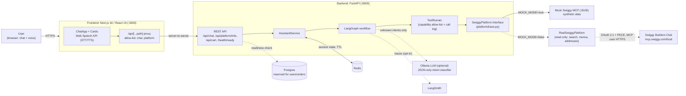
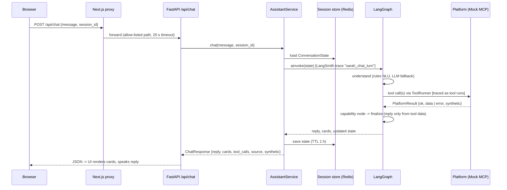
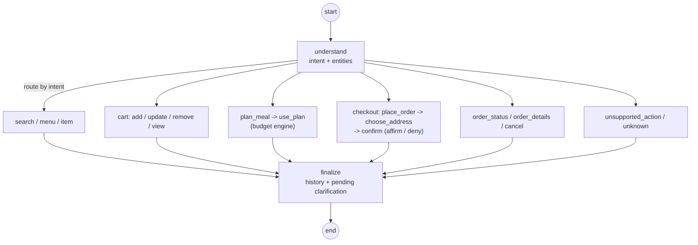

# System design: Swiggy AI Food Assistant ("Sarah")

## 1. Problem
Ordering food by chat or voice ("biryani for two under 500") instead of tapping through menus. The
assistant must never invent restaurants, prices or order states, must never place an order without an
explicit "yes", and must run at zero cost during development.

## 2. High-level architecture

## 3. Request lifecycle (one chat turn)

## 4. The agent graph

One node per capability keeps every behaviour small and unit-testable. Routing is deterministic: the
NLU picks an intent from a fixed list, and the graph maps it to exactly one node.

## 5. Components

| Component | Tech | Responsibility |
|---|---|---|
| Frontend | Next.js 16, React 19, Web Speech API | Chat UI, result cards, voice in/out, synthetic-data banner |
| Proxy route | Next.js route handler | Same-origin access to the backend, path allow-list, timeout; no CORS exposure |
| API | FastAPI, Pydantic v2 | Validation (500-char messages, session-id regex), REST + chat endpoints, health/readiness |
| Assistant | LangGraph | Stateful workflow: understand -> route -> capability node -> finalize |
| NLU | Rules (default) + Ollama (optional) | Intent and entities (dish, quantity, budget, veg, "the second one"); LLM only for messages rules can't classify, output validated as JSON |
| Budget engine | Python (budget.py) | Picks the best restaurant/combination for N people under a budget |
| ToolRunner | Python | Only declared platform capabilities can be called; every call logged and returned to the UI |
| Platform | `SwiggyPlatform` interface | Mock (MCP over HTTP) or Real; business logic never depends on a concrete platform |
| Session store | Redis (in-memory for tests) | Conversation state with TTL |
| Swiggy connection | httpx, OAuth 2.1 + PKCE | Sign-in, rotating tokens, MCP client with Swiggy's retry rules (see SWIGGY_ACCESS.md) |
| Observability | LangSmith | Per-turn traces with tool child runs, tagged by session id |
| CI | GitHub Actions | ruff + pytest, ESLint + tsc + vitest + build, Docker image builds |

## 6. Key design decisions

1. **Platform abstraction first.** All agent code talks to `app/platform/base.py`. Swapping the mock for
   the official Swiggy integration is a config change (`MOCK_MODE=false`), not a rewrite.
2. **No hallucinated facts.** Names, prices and statuses in replies are copied from tool results. Every
   mock response carries `synthetic: true`, and the UI must show a banner.
3. **Rules first, LLM second.** Rule-based NLU is free, fast and deterministic. The LLM is only a
   fallback classifier: it can choose an intent but cannot call tools or see credentials.
4. **Confirmation-gated checkout.** Placing an order needs an address choice plus an explicit "yes".
   Real orders are off by default (`ALLOW_REAL_ORDERS=false`), and production refuses to boot with
   `MOCK_MODE=true`.
5. **Honest capability gaps.** Capabilities the platform lacks return `unsupported_capability`, which the
   API maps to HTTP 501, rather than being faked.
6. **Observability is opt-in.** LangSmith tracing turns on only with `LANGSMITH_TRACING=true` and a key;
   tests force it off.

## 7. Scaling and reliability notes

- **Stateless backend.** Conversation state lives in Redis, so backend replicas can scale horizontally
  behind a load balancer with no sticky sessions.
- **Timeouts everywhere.** The proxy has 20 s, the LLM call 20 s, and readiness checks 2 s. An LLM
  failure falls back to the rules result instead of failing the request.
- **Bounded work.** Quantities are capped at 1-20, list sizes at 8, and messages at 500 characters.
- **Health vs readiness.** `/health` is liveness. `/health/ready` checks Postgres and Redis, which
  fits Kubernetes probes.
- **Next steps for production:** Google OAuth 2.0 + JWT on the checkout endpoints, persisting orders
  in Postgres, rate limiting per session, Kubernetes manifests, and mapping Swiggy's real responses once access is granted.

## 8. Testing strategy

- **Backend (pytest, ~190 tests):** NLU, budget engine, graph flows, checkout confirmation, session
  store, API contract, config guards and tracing setup. The mock MCP runs in-process through
  `httpx.ASGITransport`, so no network is needed.
- **Frontend (vitest, 80 tests):** components, hooks (chat, speech), the API client and the proxy route.
- **CI** runs all of this on every push and pull request (`.github/workflows/ci.yml`).
